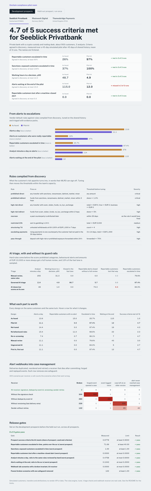

# onchain-compliance-pilot-kit

A solutions architect's kit for taking a crypto exchange, bank, fintech or payments company from a discovery call
to a measured onchain-compliance pilot within days.

1. **Discovery to rules.** The customer's risk appetite (prohibited, high-risk and restricted categories, how many
   hops, the travel-rule threshold) is compiled into a short rule list they can read. Rule types:
   - direct and indirect exposure;
   - re-screening when a counterparty is attributed later;
   - behavioural rules: 24-hour totals to restricted categories, structuring under the travel-rule threshold,
     rising payments to a new payee, and pass-through of risky deposits.

   See `ocp/kit/policy.py` and `ocp/kit/engine.py`.
2. **Replay and tuning.** The kit replays the history the customer shares and picks thresholds that reach the cases
   already on their file without exceeding their analysts' time (`ocp/kit/tune.py`).
3. **Integration.** Alerts arrive by signed webhook, are applied once and in order, and open one ticket each in case
   management. Closing a sanctions, ransomware or darknet case needs a second reviewer (`ocp/kit/webhooks.py`,
   `ocp/service/app.py`).
4. **Governed AI triage.**
   - Each alert gets an evidence pack, a score from a model trained on the shared history, and a drafted disposition
     that cites the evidence.
   - Hard rules come before the score, and analysts decide.
   - Any drafter, including an LLM, must pass the citation and number check (`ocp/kit/triage.py`).
5. **A pilot plan per prospect.** Each plan lists the rules, notes to confirm with the customer, and success
   criteria against what the simulated pilot measured (`reports/pilots/`).

It is built to sit next to blockchain-intelligence products such as transaction monitoring, wallet screening,
alert webhooks and agent integrations. The screening results here come from a simulator shaped like such an API,
not from a vendor.



## Results

<!-- results:start -->
_Generated by `ocp report` from `reports/*.json`. Do not edit by hand._

3 simulated runs per prospect: Seeblick Privatbank (fictional) in Switzerland (FINMA); Rheinwerk Digital (fictional) in Germany (BaFin); Thamesbridge Payments (fictional) in United Kingdom (FCA). Each run has 45 days of shared history (for compiling and tuning) and a 45-day pilot; every number is from the pilot window, mean of the runs.

| Prospect | Alerts a day (as found → kit) | Reportable customers escalated in time | Alerts waiting at the end | Analyst minutes a day | Success criteria met |
|---|---:|---:|---:|---:|---:|
| Seeblick Privatbank (fictional) | 13.6 → **11.1** | 25.7% → **97.4%** | 115 → **12** | 276 → **114** | 1.0 → **4.7** of 5 |
| Rheinwerk Digital (fictional) | 35.4 → **12.2** | 25.1% → **97.2%** | 453 → **7** | 633 → **143** | 1.0 → **5.0** of 5 |
| Thamesbridge Payments (fictional) | 26.4 → **9.8** | 11.2% → **96.9%** | 573 → **8** | 340 → **110** | 1.0 → **5.0** of 5 |

Webhook lab: **0 of 300** scenarios broke an invariant with the kit's receiver. Gates on the development prospects: **8 of 8 pass**.

<!-- results:end -->

Every prospect, every ablation, the webhook lab and the gates are in [REPORT.md](REPORT.md). The pilot plans are in
[reports/pilots/](reports/pilots/).

## How it is measured

`ocp.world` builds each prospect's customers from their discovery notes:
- **Customer types:** ordinary customers, gamblers, scam victims, mules, darknet buyers, structurers and sanctions
  evaders.
- **Counterparties:** twelve categories, each attributed by the intelligence with its own coverage and delay. New
  scam sites are attributed late.
- **Noise:** ordinary self-hosted wallets that touched something risky far upstream.

Each run has 45 days of history the customer shares, with 80% of the past reportable customers on their case file,
followed by a 45-day pilot. Analysts work office hours on weekdays and are right 92% of the time on their own, 96%
with a right draft and 80% with a wrong one.

| Design | What changes |
|---|---|
| As found | vendor default rules (any risky exposure, any share, any amount, 3 hops), no behavioural rules, no re-screening, manual review first in first out, alerts polled hourly |
| Pilot kit | everything above |
| Ablations | not tuned; no behavioural rules; no re-screening; manual review; ungoverned AI (low scores closed without anyone); first in first out |

**Webhook lab.** Sends alert events to the receiver with:
- duplicates, reordering and retries after timeouts;
- a receiver that dies after committing and before answering;
- forged events and replays.

It then checks that every alert has one case at its latest version and one ticket, that every event is logged once,
and that nothing forged got in.

## Run it

```bash
pip install -e ".[dev]"
pytest -q
python -m ocp.cli plan config/prospects/de-casp.yml   # compile discovery notes into rules
python -m ocp.cli dev                                 # every design on every prospect, then the reports
python -m ocp.cli gate dev
python -m ocp.cli serve                               # the API on :8080, or docker build -t ocp . && docker run -p 8080:8080 ocp
cd web && npm ci && npm run dev                       # the console
```

## Limits

- **Simulated.** Customers, transfers, attributions, analyst accuracy and the four prospects are generated; the
  prospects' names are fictional. No vendor's API or data was used. The screening simulator returns direct and
  indirect exposure the way a blockchain-intelligence API does, with a single upstream source per transfer.
- **The triage model is trained on simulated labels.** On real alerts it would need the customer's dispositions and
  a check for drift. The default drafter is a template; an LLM drafter can be plugged in behind the same check, and
  the tests show a drafter that invents a number being replaced.
- **Review is modelled in minutes per alert.** Real investigations vary more; the 25/12/3-minute estimates are
  settings in `config/kit.yml`.
- **Regulation is simplified.** The travel-rule threshold and escalation deadlines come from the discovery notes;
  the kit does not decide what a jurisdiction requires. Filing a suspicious-activity report stays with the
  customer's MLRO.
- Built in my own project time, not yet run at an employer.

## Repository

`AGENTS.md` (invariants and the held-out rule), `SKILLS.md` (repeatable tasks), `docs/adr/` (decisions), `config/`
(discovery notes, kit settings and gates), `reports/` (generated results and pilot plans), `web/` (React console).
